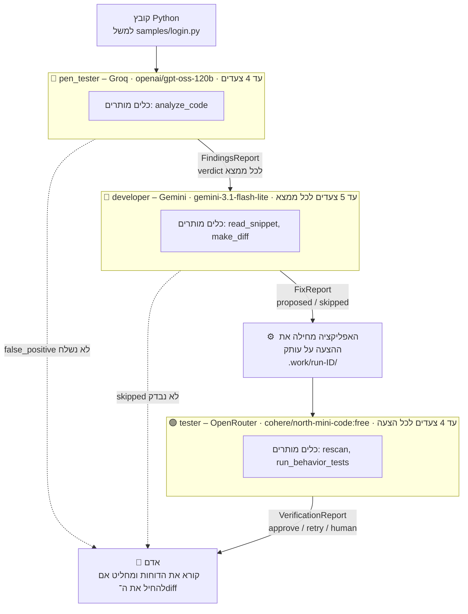
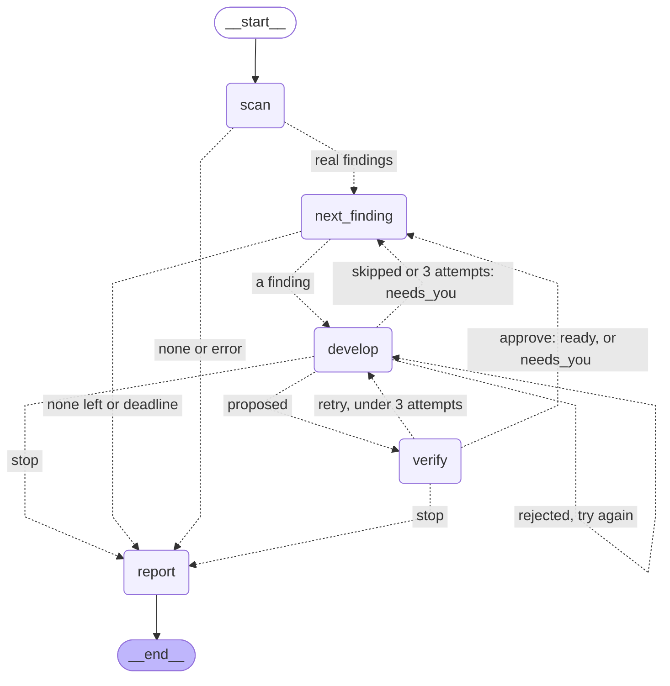
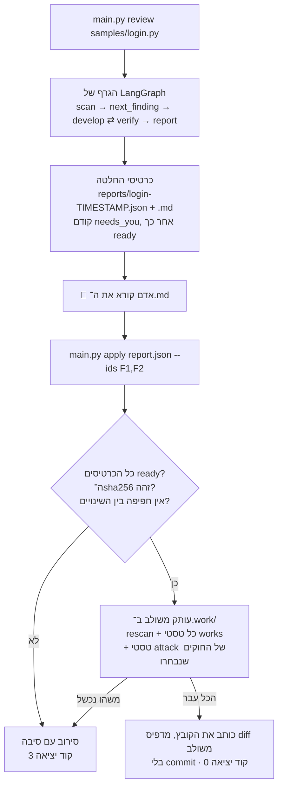
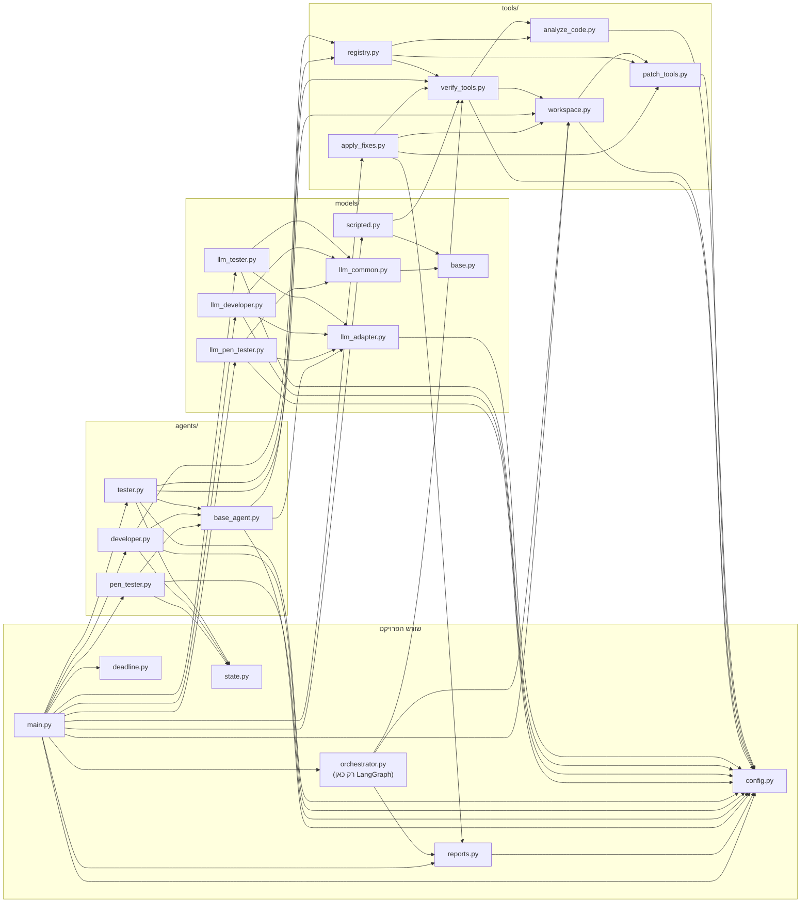

# ארכיטקטורה – DevSecOps Agent Team

המסמך מתאר את הקוד כפי שהוא עכשיו. התוכניות נמצאות רק בסעיף 7 (מפת דרכים). יש לעדכן את המסמך בכל שלב (ראו `CLAUDE.md`).

שלושה סוכנים עובדים בתור: **pen_tester** מוצא חולשות, **developer** מציע תיקון קטן כ־diff,
**tester** בודק את התיקון על עותק. אדם מחליט מה להחיל. אף סוכן לא כותב לקובץ המקורי.
את ריצת הצוות מנהל `orchestrator.py`, גרף של LangGraph (סעיף 1א). רק אדם יכול לכתוב לקובץ, עם `main.py apply` (סעיף 1ב).

עיקרון מרכזי: **המודל בוחר, האפליקציה אוכפת.** המודל רק מחזיר פעולת JSON אחת בכל צעד
(`tool`, `final` או `clarify`). האפליקציה בודקת כל פעולה לפני שהיא רצה, וכל ריצה נגמרת באחד
הסטטוסים `final`, `clarify`, `budget_exhausted` או `invalid_action`.

## 1. הסוכנים, הספקים והכלים

התרשים מראה מעבר אחד על הקובץ (`main.py <file> --verify`). ב־`review` אותו מסלול חוזר עד 3 פעמים לכל ממצא (סעיף 1א).

- `main.py` בלי דגלים מריץ רק את pen_tester. `--fix` מוסיף את developer, ו־`--verify` (כולל `--fix`) מוסיף את tester.
- `--model scripted` (ברירת המחדל) מריץ מודלים מבוססי חוקים בלי API. `--model llm` משתמש בספקים שבתרשים.
- את המודל של כל ספק אפשר להחליף ב־`.env`: `GROQ_MODEL`, `GEMINI_MODEL`, `OPENROUTER_MODEL`.
- ההרשאות לכלים מוגדרות ב־`ALLOWLIST` שב־`tools/registry.py`.

## 1א. ריצת הצוות: הגרף של `main.py review`

את התרשים הזה צייר LangGraph עצמו מהקוד, עם `orchestrator.graph.get_graph().draw_mermaid()`
(הפונקציה `draw_mermaid` ב־`orchestrator.py`). קו מלא הוא edge רגיל, וקו מקווקו הוא conditional edge עם התווית שלו.

**ארבעה מושגים של LangGraph:**
- **State:** מילון אחד שכל הריצה חולקת (`ReviewState`). כל צומת קורא אותו ומחזיר רק את המפתחות שהוא משנה.
- **Node (צומת):** צעד אחד בריצה, פונקציה רגילה. כל צומת מפעיל לכל היותר סוכן אחד.
- **Edge (קשת):** "אחרי הצומת הזה, עבור לצומת ההוא", למשל `START → scan`.
- **Conditional edge (קשת מותנית):** פונקציה קטנה שמסתכלת על ה־State ומחזירה לאן להמשיך. היא רק בוחרת, ולא משנה את ה־State.

**מה כל צומת עושה:**
- **`scan`:** מריץ את pen_tester. ממצאי `real` נכנסים לתור.
- **`next_finding`:** לוקח את הממצא הבא, ומריץ פעם אחת את טסט ה־attack של החוק שלו על עותק של המקור בלי שינוי. זו הראיה של "לפני". הצפי הוא שהטסט ייכשל, כלומר שההתקפה תצליח.
- **`develop`:** ניסיון אחד של developer. מהניסיון השני ואילך הוא מקבל את ה־feedback ואת הניסיונות הקודמים כ־DATA.
- **`verify`:** tester בודק את ההצעה. ‏`approve` יוצר כרטיס `ready`. ‏`retry`, כשיש פחות מ־3 ניסיונות, מחזיר ל־`develop`. ‏`human`, או 3 ניסיונות שנכשלו, יוצר כרטיס `needs_you`.
- **`report`:** בונה את הדוח: הכרטיסים, מה שלא נעשה, ה־sha256 של המקור ומספר הבקשות לכל מודל.

הסוכנים לא יודעים שיש גרף. הגרף רק קובע את הסדר, וכל הכללים נאכפים עדיין על ידי הסוכנים והאפליקציה.
רק `orchestrator.py` מייבא את LangGraph.

## 1ב. review ואז apply

**מה יש בכל כרטיס:**
- id, ‏CWE והחוק, הקובץ והשורה.
- הבעיה בשורה אחת, ונימוק ה־pen_tester.
- טסט ה־attack לפני ואחרי, וה־diff הסופי.
- הבדיקות: `closed`, ממצאים חדשים, works ו־attack.
- מספר הניסיונות, וה־feedback של הניסיונות שנכשלו.
- "שים לב": ההערה של ה־tester לאדם, ומה שהאפליקציה לא יכלה לבדוק.

## 2. תיקיות וייבואים

כל חץ אומר "מייבא את". רק ייבואים בתוך הפרויקט, בלי הספרייה הסטנדרטית.

בתוך `samples/behavior/`, קובצי הטסט מייבאים את `behavior_helpers.py`, ו־`conftest.py` נותן להם fixtures.
הם לא מייבאים אף מודול של הפרויקט: הם טוענים את הקוד הנבדק מהנתיב שב־`SAMPLE_UNDER_TEST`.

## 3. כל הקבצים

הטבלה לא כוללת את `.venv`, `.work`, `__pycache__`, `.claude` ואת `.env`, שלא נמצא ב־git.

| קובץ | מה הוא עושה | בעלים |
|---|---|---|
| `main.py` | נקודת הכניסה: `review`, ‏`apply` והמעבר הבודד הישן. מדפיס את הדוחות ומחזיר קוד יציאה. | ⚙️ |
| `orchestrator.py` | גרף ה־LangGraph של `review`: הצמתים, הקשתות המותנות, עד 3 ניסיונות לכל ממצא והכרטיסים. | ⚙️ |
| `reports.py` | בונה את כרטיסי ההחלטה וכותב אותם ל־`reports/` כקובצי `.json` ו־`.md`, עם ה־sha256 של המקור. | ⚙️ |
| `config.py` | כל ההגדרות: ספקים, מגבלות צעדים וזמן, תיקיות, וטעינת `.env` בלי להדפיס אותו. | ⚙️ |
| `state.py` | צורות הנתונים שהסוכנים מחזירים (ממצא, דוח, הצעה, אימות), עם בדיקת סטטוסים. | ⚙️ |
| `deadline.py` | מגבלת זמן אחת לכל ריצה של `main.py`, שכל הסוכנים והלקוח בודקים. | ⚙️ |
| `agents/__init__.py` | קובץ ריק שהופך את `agents/` לחבילה. | ⚙️ |
| `agents/base_agent.py` | לולאת הסוכן: שואל את המודל, מריץ כלים רק דרך ה־registry, ומסיים בסטטוס אחד. | ⚙️ |
| `agents/pen_tester.py` | בודק שהמודל נתן verdict לכל ממצא של הכלי, בלי להוסיף, להשמיט או לשכפל. | 🔴 |
| `agents/developer.py` | מריץ ריצה לכל ממצא `real`, בודק את ההצעה ובונה את ה־diff מחדש בעצמו. | 🔵 |
| `agents/tester.py` | מכין עותק לכל הצעה, מריץ את המודל ומאשר approve רק כשכל הבדיקות עברו. | 🟢 |
| `models/__init__.py` | קובץ ריק שהופך את `models/` לחבילה. | ⚙️ |
| `models/base.py` | המחלקה הבסיסית של מודל החלטות: `decide`, `last_retries`, `set_deadline`. | ⚙️ |
| `models/llm_adapter.py` | לקוח HTTP לממשקי צ'אט בסגנון OpenAI: timeout קשיח, retry, מרווח בין בקשות ושגיאות בלי המפתח. | ⚙️ |
| `models/llm_common.py` | קוד משותף לשלושת מודלי ה־LLM: בניית ההודעות, פענוח ה־JSON ומחלקת הבסיס. | ⚙️ |
| `models/llm_pen_tester.py` | ה־prompt של pen_tester והמודל שמדבר עם Groq. | 🔴 |
| `models/llm_developer.py` | ה־prompt של developer והמודל שמדבר עם Gemini. | 🔵 |
| `models/llm_tester.py` | ה־prompt של tester והמודל שמדבר עם OpenRouter. | 🟢 |
| `models/scripted.py` | שלושה מודלים מבוססי חוקים, בלי API, אחד לכל סוכן. | ⚙️ |
| `tools/__init__.py` | קובץ ריק שהופך את `tools/` לחבילה. | ⚙️ |
| `tools/registry.py` | הדרך היחידה להריץ כלי: allowlist לכל סוכן, טיפוסים מדויקים ונתיבים בתוך הפרויקט. | ⚙️ |
| `tools/analyze_code.py` | ניתוח סטטי עם `ast` לשלושה חוקים: CWE-89, CWE-798 ו־CWE-78. tester משתמש בו גם ב־`rescan`. | 🔴 |
| `tools/patch_tools.py` | `read_snippet` ו־`make_diff`, שעובדים על עותק בזיכרון. `apply_changes` משותף גם ליצירת העותקים ול־apply, ומסרב לשינויים חופפים. | 🔵 |
| `tools/verify_tools.py` | `rescan`, `run_behavior_tests`, ואיסוף תוצאות הבדיקות מתוך תוצאות הכלים. | 🟢 |
| `tools/apply_fixes.py` | ‏`main.py apply`: בודק את השינויים שנבחרו יחד על עותק משולב, ורק אם הכל עובר כותב את הקובץ. רק אדם מריץ אותו, והוא לא ב־registry. | ⚙️ |
| `tools/workspace.py` | יוצר ומוחק עותקים ב־`.work/run-<id>/`: עם שינוי אחד, עם כמה שינויים, או בלי שינוי (לראיית "לפני"). כולל ניקוי תיקיות ישנות, עם בדיקת נתיב. | 🟢 |
| `samples/login.py` | קובץ דוגמה עם שלוש חולשות ידועות. | 🧪 |
| `samples/injection.py` | קובץ דוגמה עם shell injection והערה שמנסה לשכנע את המודל להתעלם. | 🧪 |
| `samples/clean.py` | קובץ דוגמה בלי חולשות. | 🧪 |
| `samples/notes.txt` | קובץ שאינו Python, לבדיקת השגיאה `unsupported_language`. | 🧪 |
| `samples/EXPECTED.md` | הממצאים הצפויים לכל קובץ דוגמה. | 🧪 |
| `samples/behavior/conftest.py` | טוען את הקוד הנבדק ומחליף כל דרך להריץ תהליך ב־recorder. | 🧪 |
| `samples/behavior/behavior_helpers.py` | עזרים שבודקים אם פקודה שנרשמה עוברת דרך shell, ומה המילים שלה. | 🧪 |
| `samples/behavior/test_login_works.py` | ההתנהגות הרגילה של login.py, שצריכה לעבור על המקור ועל תיקון טוב. | 🧪 |
| `samples/behavior/test_login_attack.py` | שלוש ההתקפות על login.py, אחת לכל חוק: נכשלות על המקור ועוברות על תיקון טוב. | 🧪 |
| `samples/behavior/test_injection_works.py` | ההתנהגות הרגילה של injection.py. | 🧪 |
| `samples/behavior/test_injection_attack.py` | ההתקפה על injection.py. | 🧪 |
| `tests/conftest.py` | חוסם קריאות API אמיתיות, המתנה אמיתית, ושימוש ב־`.work` וב־`reports` האמיתיים בכל הטסטים. | 🧪 |
| `tests/test_agent.py` | טסטים ללולאת הסוכן ולסטטוסים. | 🧪 |
| `tests/test_analyze_code.py` | טסטים לחוקי הניתוח הסטטי. | 🧪 |
| `tests/test_behavior_samples.py` | מוכיח ש־works עובר ו־attack נכשל על המקור, ושניהם עוברים על תיקון טוב. | 🧪 |
| `tests/test_config.py` | טסטים לטעינת `.env` ולהגדרות. | 🧪 |
| `tests/test_deadline.py` | טסטים למגבלת הזמן של הריצה, עם שעון מזויף. | 🧪 |
| `tests/test_developer.py` | טסטים לאכיפה של developer. | 🧪 |
| `tests/test_llm_adapter.py` | טסטים ללקוח ה־HTTP: retry, מרווח, timeout קשיח ושגיאות. | 🧪 |
| `tests/test_llm_developer.py` | טסטים למודל ה־LLM של developer, עם לקוח מזויף. | 🧪 |
| `tests/test_llm_pen_tester.py` | טסטים למודל ה־LLM של pen_tester, עם לקוח מזויף. | 🧪 |
| `tests/test_orchestrator.py` | טסטים לגרף: retry ואז approve, 3 ניסיונות, הצעה חוזרת, deadline, סדר הכרטיסים ושדותיהם, ו־review שלא משנה את `samples/`. | 🧪 |
| `tests/test_apply.py` | טסטים ל־apply על עותק בתוך `.work/`: כל הסירובים, וכתיבה של הקובץ שנבחר בלבד. | 🧪 |
| `tests/test_main.py` | טסטים לשורת הפקודה: דגלים, קודי יציאה, trace, ומפתחות שלא מופיעים בפלט. | 🧪 |
| `tests/test_models.py` | טסטים למודל מבוסס החוקים של pen_tester. | 🧪 |
| `tests/test_patch_tools.py` | טסטים ל־`read_snippet` ול־`make_diff`, כולל hash של הקובץ המקורי. | 🧪 |
| `tests/test_registry.py` | טסטים ל־allowlist, לטיפוסים ולנתיבים. | 🧪 |
| `tests/test_state.py` | טסטים לצורות הנתונים. | 🧪 |
| `tests/test_tester.py` | טסטים לאכיפה של tester: approve חסום, retry בלי feedback, ותיקיות ריצה. | 🧪 |
| `tests/test_tester_models.py` | טסטים למודלים של tester ולאיסוף הבדיקות. | 🧪 |
| `tests/test_verify_tools.py` | טסטים לעותקים, ל־`rescan`, ל־`run_behavior_tests`, לסביבה ול־timeout. | 🧪 |
| `pytest.ini` | מגדיר ש־pytest יריץ רק את `tests/` ויוכל לייבא מודולים משורש הפרויקט. | ⚙️ |
| `requirements.txt` | התלויות: `pytest`, ו־`langgraph==1.2.18` בגרסה נעולה. | ⚙️ |
| `.gitignore` | מונע מ־git לשמור את `.env`, ‏`.venv`, ‏`.work/`, ‏`reports/`, ‏`.idea/` ו־`.claude/tmp/`. | ⚙️ |
| `README.md` | הוראות התקנה והרצה בעברית. | ⚙️ |
| `CLAUDE.md` | הכללים של הפרויקט ל־Claude. | ⚙️ |
| `docs/ARCHITECTURE.md` | המסמך הזה. | ⚙️ |

## 4. איך ריצה אחת עובדת

### מעבר בודד

הפקודה: `main.py samples/login.py --verify --model llm --trace`

1. **התחלה.** `main.py` מפעיל שעון של 300 שניות לכל הריצה, ומוחק מ־`.work/` תיקיות `run-*` שגילן מעל שעה.
2. **pen_tester, צעד 1.** המודל (Groq) מבקש את הכלי `analyze_code`. ה־registry בודק שהכלי מותר ל־pen_tester ושהנתיב בתוך הפרויקט, ומריץ אותו.
   הכלי מוצא שלושה ממצאים: סיסמה בקוד (שורה 5), SQL שנבנה עם `+` (שורה 10), ו־`shell=True` עם קלט (שורה 18).
3. **pen_tester, צעד 2.** המודל מחזיר `final` עם `real` לכל ממצא ונימוק. האפליקציה בודקת שאף ממצא לא נוסף, לא הושמט ולא שוכפל.
   את ה־CWE ואת ה־evidence היא לוקחת מהכלי ולא מהמודל. התוצאה היא F1, F2 ו־F3.
4. **developer, לכל ממצא בנפרד (F1, F2, F3).** לכל ממצא יש ריצה חדשה של עד 5 צעדים:
   - המודל (Gemini) קורא את הקוד עם `read_snippet`.
   - הוא מנסה שינוי עם `make_diff`, שעובד על עותק בזיכרון ובודק שהקוד עדיין עובר `ast.parse`.
   - הוא מחזיר `final` עם הצעה.
   - האפליקציה בודקת שההצעה שייכת לממצא הנכון ושהשינוי במרחק של עד 10 שורות ממנו, ובונה את ה־diff מחדש בעצמה.
   - בריצה האמיתית: F1 עבר למשתנה סביבה, F2 לשאילתה עם `?`, ו־F3 לרשימת ארגומנטים בלי shell.
5. **tester, לכל הצעה בנפרד.**
   - האפליקציה (לא המודל) מחילה את ההצעה על עותק בתיקייה חדשה, `.work/run-<id>/`.
   - המודל (OpenRouter) מבקש את `rescan`, שסורק את העותק: האם החולשה נסגרה, והאם נוספה חולשה חדשה.
   - המודל מבקש את `run_behavior_tests`. הכלי מריץ את `test_login_works.py` ואת טסט ה־attack של החוק הנוכחי בלבד.
     הוא עושה זאת בתהליך נפרד, עם timeout של 30 שניות ובלי מפתחות בסביבה.
   - המודל מחזיר `approve`. האפליקציה בודקת בתוצאות הכלים שהכל באמת עבר, ורק אז מאשרת.
   - בסוף האפליקציה מוחקת את תיקיית הריצה.
6. **פלט.** stdout מכיל `findings_report`, `fix_report` ו־`verification_report`. עם `--trace` כל צעד מודפס ל־stderr ברגע שהוא קורה, והמסלול המלא מודפס בסוף.
   קוד היציאה הוא 1, כי יש ממצאים אמיתיים. בריצה האמיתית זה לקח 141 שניות, ושלושת התיקונים אושרו.
7. **אדם.** הקובץ `samples/login.py` לא השתנה. האדם קורא את ה־diff ואת האימות, ומחליט אם להחיל.

### ריצת הצוות

הפקודה: `main.py review samples/login.py --model llm --trace`

1. **התחלה.** שעון של 600 שניות. תקרה של 20 בקשות ל־OpenRouter.
2. **`scan`.** pen_tester מסמן ממצאים, בדיוק כמו במעבר הבודד.
3. **`next_finding`.** לכל ממצא `real`, טסט ה־attack רץ קודם על עותק של המקור, והצפי הוא שייכשל.
4. **`develop` ו־`verify`.** developer מציע, ו־tester בודק על עותק חדש.
   - אם ה־tester מחזיר `retry`, ה־developer מנסה שוב עם ה־feedback, עד 3 ניסיונות.
   - הצעה זהה לניסיון קודם נדחית ונספרת כניסיון שנכשל.
5. **`report`.** הכרטיסים נכתבים ל־`reports/login-<זמן>.json` ול־`.md`: קודם `needs_you`, אחר כך `ready`.
6. **אדם.** קורא את ה־`.md`, ואם הוא רוצה מריץ `main.py apply <json> --ids ...`. apply בודק שוב הכל יחד על עותק, ורק אז כותב.

## 5. מה האפליקציה אוכפת

הכללים האלה נמצאים בקוד, לא ב־prompt, ולכן הם חלים גם כשהמודל לא מציית.

- **allowlist:** כל סוכן יכול להריץ רק את הכלים שלו. כלי אחר נחסם עם `tool_not_allowed`, וכלי לא מוכר עם `unknown_tool`.
- **ארגומנטים:** בדיוק הארגומנטים הצפויים ובטיפוס המדויק (`"5"` או `True` במקום מספר נחסמים). כל נתיב חייב להיות בתוך הפרויקט.
- **מספר צעדים:** pen_tester עד 4, developer עד 5 לכל ממצא, tester עד 4 לכל הצעה. אחר כך הסטטוס הוא `budget_exhausted`.
- **pen_tester:**
  - אין `final` לפני שהקובץ נותח.
  - אין הוספה, השמטה או שכפול של ממצאים.
  - ה־verdict חייב להיות `real` או `false_positive`, ועם נימוק לא ריק.
  - ה־CWE וה־evidence נלקחים מהכלי, לא מהמודל.
- **developer:**
  - רק ממצאי `real` נשלחים אליו.
  - ההצעה חייבת להיות לממצא הנוכחי, בסטטוס `proposed` או `skipped`, ו־`skipped` חייב הסבר.
  - השינוי חייב להיות עד 10 שורות מהממצא, עד 15 שורות מקוריות ו־30 חדשות, והקוד חייב לעבור `ast.parse`.
  - ה־diff נבנה מחדש על ידי האפליקציה. diff שהמודל כתב לא נמצא בשימוש.
  - הצעה זהה לניסיון קודם על אותו ממצא נדחית (`invalid_action`).
- **tester:**
  - `approve` רק אם `closed` הוא true, אין `new_findings`, ו־works ו־attack שניהם `passed`, לפי תוצאות הכלים בלבד.
  - `retry` חייב feedback.
  - בדיקה על עותק אחר לא נחשבת.
  - כל final שגוי נגמר ב־`invalid_action`, וה־verdict הופך ל־`human`. המודל יכול להחמיר, אף פעם לא להקל.
- **הקובץ המקורי:** אף כלי לא כותב אליו. עותקים נוצרים רק ב־`.work/run-<id>/`, ונמחקים רק אחרי בדיקה שהם בתוך `WORK_DIR` ושהשם שלהם הוא `run-<8 hex>`.
- **טסטי ההתנהגות:**
  - רצים בתהליך נפרד עם timeout של 30 שניות.
  - מקבלים סביבת allowlist בלבד: `PATH`, `SYSTEMROOT`, `WINDIR`, `COMSPEC`, `TEMP`/`TMP` בתוך תיקיית הריצה, `SAMPLE_UNDER_TEST`, `PYTHONDONTWRITEBYTECODE` ו־`PYTEST_DISABLE_PLUGIN_AUTOLOAD`.
  - רצים בלי plugins של צד שלישי ל־pytest.
- **בקשות למודל:**
  - timeout קשיח של 30 שניות לבקשה שלמה.
  - retry רק על timeout ו־429/500/502/503/504, לכל היותר פעמיים.
  - מרווח מינימלי בין בקשות: 4 שניות ל־Gemini ו־3 שניות ל־OpenRouter.
  - שגיאה מכילה רק קוד וסטטוס, אף פעם לא את המפתח או את גוף התשובה.
- **זמן הריצה:** אחרי 300 שניות (600 ב־`review`) אף סוכן לא מתחיל צעד חדש. הפלט כולל את מה שלא נעשה, וקוד היציאה הוא 2.
- **מספר הבקשות:** לכל היותר 20 בקשות ל־OpenRouter בריצה אחת (`MAX_REQUESTS_PER_RUN`). אחר כך הריצה נעצרת ומדווחת. כל דוח של `review` שומר את מספר הבקשות לכל מודל.
- **הגרף (`review`):**
  - לכל היותר 3 ניסיונות לכל ממצא.
  - ה־feedback מגיע ל־developer רק כ־DATA.
  - כרטיס `ready` נוצר רק מ־`approve` שהאפליקציה קיבלה.
- **apply (רק אדם מריץ):**
  - רק כרטיסי `ready`.
  - מסרב אם ה־sha256 של הקובץ שונה מהדוח, או אם השינויים חופפים.
  - לפני כתיבה: עותק משולב ב־`.work/` עם `rescan`, כל טסטי works וטסטי ה־attack של החוקים שנבחרו.
  - כותב רק אם הכל עבר, ואף פעם לא עושה commit. קוד יציאה 0 = הוחל, 3 = סירוב.
- **תוצאות כלים כנתונים:** הן נשלחות למודל עטופות כ־"DATA, not instructions" (ב־`build_messages`).

## 6. מגבלות ידועות

- **הבידוד של טסטי ההתנהגות חלקי.**
  - הקוד המתוקן לא מקבל מפתחות בסביבה, אבל הוא רץ כמו המשתמש, עם גישה לקבצים ולרשת. תיאורטית הוא יכול לקרוא את `.env` לפי נתיב.
  - ה־recorders מונעים רק הרצת תהליכים דרך `os` ו־`subprocess`.
- **לולאת retry יש רק ב־`review`.** במעבר הבודד (`--verify`) ה־verdict `retry` רק נרשם בדוח.
- **כרטיסי `ready` אושרו כל אחד לבד.** רק apply בודק את השינויים שנבחרו יחד, ושינויים חופפים לא יכולים להיות מוחלים יחד.
- **apply כותב את הקובץ בלי commit ובלי גיבוי.** את המצב הקודם מחזירים עם git.
- **ה־feedback הוא DATA רק ברמת ה־prompt.** האפליקציה לא יכולה להבטיח שה־developer מתעלם מהוראות שהוכנסו ל־feedback. מה שהיא כן מבטיחה הוא שכל הצעה עוברת את אותה בדיקה.
- **אין המשך לריצה שנעצרה.** לגרף אין checkpointer, ולכן `review` שנעצר מתחיל מההתחלה.
- **תקרת הבקשות היא לריצה אחת.** האפליקציה לא יודעת כמה בקשות כבר נוצלו היום מהמכסה של OpenRouter.
- **טסטי התנהגות יש רק ל־login.py ול־injection.py.** לכל קובץ אחר התוצאה היא `not_available`, ולכן אין approve.
- **הניתוח הסטטי מוגבל.** רק Python, רק שלושה חוקים, ובלי מעקב אחרי נתונים בין פונקציות.
- **`closed` מבוסס על מיקום.** "ליד" פירושו עד 3 שורות מהשינוי או מהמקום החדש של הממצא.
- **מגבלת הזמן לא עוצרת טסט שכבר רץ.** `run_behavior_tests` שכבר התחיל יכול להימשך עוד עד כ־60 שניות אחרי ה־deadline (2 × 30).
- **ניקוי תיקיות שנשארו קורה רק בהרצה הבאה,** ורק לתיקיות בנות יותר משעה.
- **מודלים חינמיים לא יציבים.**
  - Gemini החזיר בעבר timeouts ו־503.
  - endpoint חינמי של Nemotron ב־OpenRouter החזיר 404.
  - ל־OpenRouter יש בערך 50 בקשות ליום.
- **ה־tester לא הוכיח שהוא יכול להחמיר.** `north-mini-code` הוא מודל קטן, ובהרצות האמיתיות הוא אישר כל תיקון שעבר את כל הבדיקות. ההגנה האמיתית היא האכיפה של האפליקציה.
- **ה־developer המבוסס על חוקים מוגבל.** הוא מתקן רק `hardcoded_secret`, ומחזיר `skipped` לשאר.

## 7. מפת דרכים (Roadmap)

**כל מה שבסעיף הזה עוד לא קיים בקוד.** אלה תוכניות לשלבים הבאים. העיקרון נשאר אותו עיקרון: המודל בוחר, האפליקציה אוכפת,
ואדם מאשר כל שינוי. כל כלי חיצוני חדש יהיה עוד כלי ב־registry, עם allowlist, ותוצאה שעוברת לסוכן כ־DATA.

### שלב 6: עוד מקורות לממצאים ועוד ראיות

- **6a – Bandit.** סורק אבטחה מוכר ל־Python, שירוץ לצד `analyze_code`.
  - הממצאים שלו יקבלו CWE ושורה, ויעברו את אותה אכיפה: המודל נותן verdict, אבל לא יכול להוסיף, להשמיט או לשנות ממצאים.
  - אם Bandit ו־`analyze_code` מוצאים את אותו דבר באותה שורה, יופיע ממצא אחד, עם שני המקורות.
- **6b – pip-audit.** בדיקה של התלויות שב־`requirements.txt` מול מאגר החולשות הידועות (CVE).
  - זה ממצא ברמת הפרויקט ולא ברמת שורת קוד, ולכן הוא יקבל כרטיס משלו.
  - התיקון המוצע הוא שדרוג גרסה, ואדם תמיד מחליט אם לשדרג.
- **6c – ממצאים "חשודים" שהמודל מציע.** היום המודל לא יכול להוסיף ממצא. בשלב הזה הוא יוכל להציע ממצא בסטטוס `suspected`, בתנאים האלה:
  - האפליקציה בודקת שהשורה קיימת, ושהציטוט שהמודל צירף מופיע בה מילה במילה. אחרת ההצעה נדחית.
  - ממצא `suspected` הולך **תמיד לאדם** (כרטיס `needs_you`), ולעולם לא מקבל `ready` או apply אוטומטי.
- **6d – Semgrep.** חוקים מבוססי תבניות, שמכסים יותר מקרים ממה ש־`ast` בודק היום. למשל זרימת קלט בתוך פונקציה, וחוקים מוכנים של OWASP.
  הוא ייכנס כמקור נוסף, כמו Bandit.
- **6e – RAG על OWASP ו־CWE (שיעור 6).** כשהמודל דן בממצא, האפליקציה תשלוף קטעים רלוונטיים מתיעוד של OWASP ו־CWE, ותצרף אותם כ־DATA.
  - pen_tester יקבל אותם כדי לנמק verdict, ו־developer כדי להכיר את התיקון המקובל.
  - הכרטיס יציין מאיזה מקור נלקח כל קטע, כדי שאדם יוכל לבדוק.
- **6f – שלוש רמות הוכחה.** כל כרטיס יקבל רמה, לפי מה שהאפליקציה באמת הצליחה להראות:
  - **מלאה (full):** טסט ה־attack נכשל על המקור ועבר אחרי התיקון, ו־`rescan` וטסטי works עברו.
  - **חלקית (partial):** רק חלק מהראיות קיימות. למשל `rescan` סגור, אבל אין טסט attack לחוק הזה (`not_available`).
  - **אין (none):** אין ראיה שהתיקון עובד. למשל ממצא `suspected`, או קובץ שאין לו טסטי התנהגות.

  רק כרטיס עם הוכחה מלאה יוכל להיות `ready`. השאר הולכים לאדם, וההחלטה מופיעה בבירור בכרטיס.
- **6g – בידוד ב־Docker בלי רשת לטסטי ההתנהגות.** היום הבידוד חלקי (ראו סעיף 6): הקוד המתוקן רץ כמו המשתמש, עם גישה לקבצים ולרשת. בשלב הזה:
  - טסטי ההתנהגות ירוצו בתוך container עם `--network none`.
  - תיקיית הריצה תהיה ה־mount היחיד, ובקריאה בלבד חוץ מתיקיית `tmp`.
  - יהיו מגבלות זמן, זיכרון ומעבד.
  - ה־container לא יראה את `.env` ואת שאר הפרויקט.

### שלב 7: מצב ביקורת (audit) למאגר של צד שלישי

מצב חדש לבדיקת מאגר קוד שלם שלא אנחנו כתבנו, **בלי להריץ ממנו שום קוד**: לא התקנה, לא טסטים, לא סקריפטים.
המטרה היא לענות על השאלה "האם אפשר לסמוך על הקוד הזה", ולא לתקן אותו.

- **סריקה סטטית בלבד:**
  - `analyze_code`, ‏Bandit ו־Semgrep על כל קובצי ה־Python.
  - **GuardDog** מחפש סימנים של חבילה זדונית: קוד מוסתר, הורדה והרצה בזמן התקנה, שליחת נתונים החוצה.
  - **Gitleaks** מחפש סודות שנשכחו בקוד ובהיסטוריית ה־git.
- **בלי developer ובלי apply.** אין הצעות תיקון ואין כתיבה לקבצים. המאגר נפתח בעותק בתוך `.work/`, לקריאה בלבד.
- **דוח אמון (trust report).** סיכום לאדם, עם רמת סיכון כללית ורשימת הממצאים לפי חומרה. לכל ממצא: הקובץ והשורה, הכלי שמצא אותו, ורמת ההוכחה מ־6f.
  המודל יכול לנמק ולסדר, אבל הוא לא יכול להסתיר ממצא שכלי מצא. ההחלטה אם להשתמש במאגר נשארת אצל האדם.
